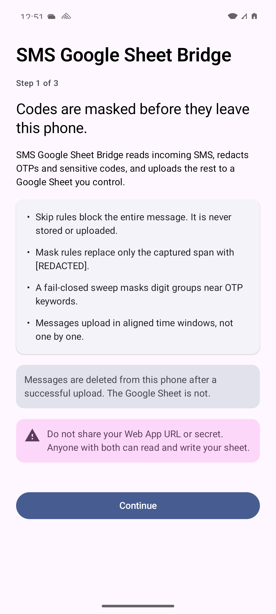
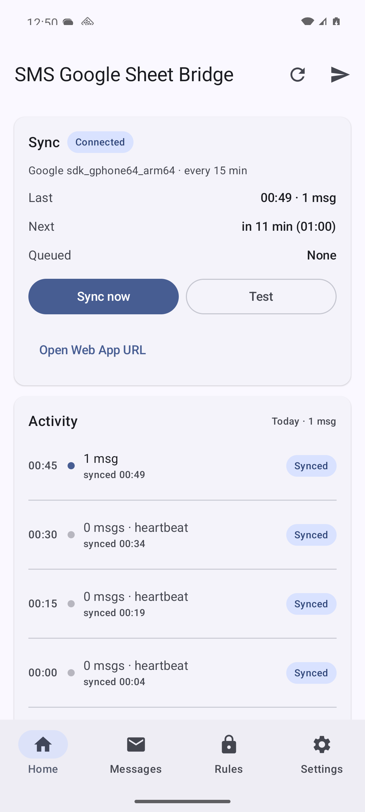
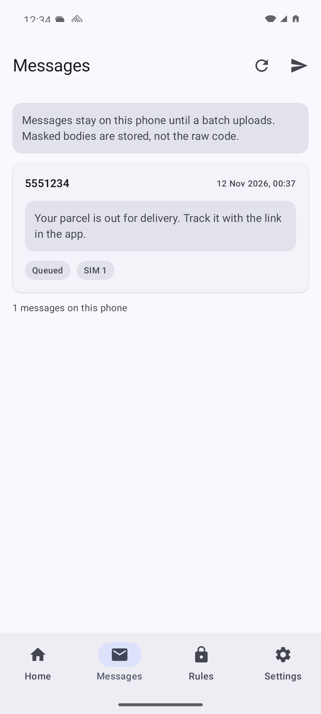
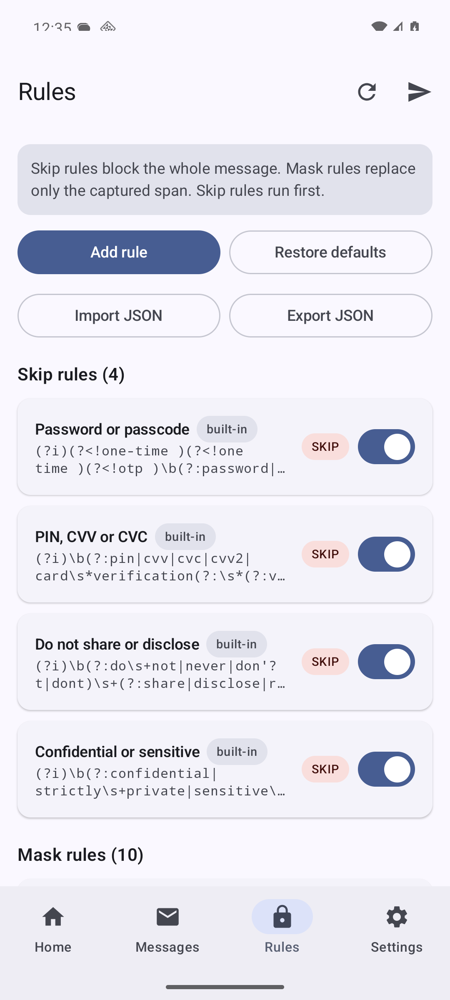
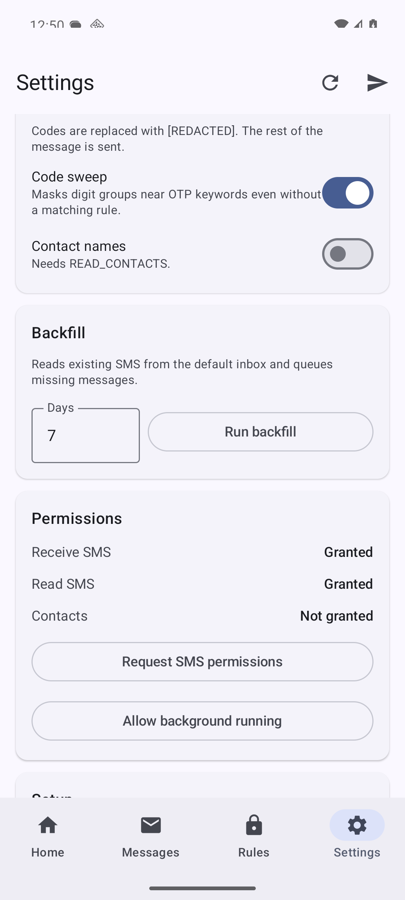

# SMS Google Sheet Bridge

An Android app that forwards incoming SMS to a Google Sheet, with OTP and sensitive-code redaction performed on the phone before anything leaves it.

The app is self-hosted: you run the Android app, you own the Google Sheet, and you deploy the small Apps Script endpoint. There is no vendor backend, no account, and no analytics. This repository contains **no deployment URL, no shared secret, and no signing keys**. Everything is configured at runtime.

> Status: side-load / personal-use project. Not published on Google Play. Read [Limitations](#limitations) before relying on it.

## Download

[Download the latest APK](https://github.com/prakashchokalingam/sms-google-sheet-bridge/releases/latest/download/sms-google-sheet-bridge.apk) · [All releases](https://github.com/prakashchokalingam/sms-google-sheet-bridge/releases)

- Version 0.1.1; Android 8.0 (API 26) or newer.
- SHA-256: `f32f3e0f2f55b72c6d7b1701340784d8c1f1efd2e30f1eb3f6e8f9ff73502c65`
- Side-load only. Play Protect may warn because the app is not distributed through Google Play.
- The APK contains no deployment URL or shared secret. You still deploy your own Apps Script endpoint and enter both values in the app.
- v0.1.1 uses a new application ID. If you installed v0.1.0, uninstall it first; local settings and history do not migrate.

<p align="center">
  
  
  
</p>
<p align="center">
  
  
</p>

## Contents

- [Download](#download)
- [How it works](#how-it-works)
- [Redaction model](#redaction-model)
- [Batching and delivery](#batching-and-delivery)
- [Security model](#security-model)
- [Requirements](#requirements)
- [Build and install](#build-and-install)
- [Google Apps Script setup](#google-apps-script-setup)
- [App configuration](#app-configuration)
- [Sheet schema](#sheet-schema)
- [Rules and import/export](#rules-and-importexport)
- [Testing](#testing)
- [Troubleshooting](#troubleshooting)
- [Repository layout](#repository-layout)
- [Limitations](#limitations)
- [License](#license)

## How it works

```
+----------------+     SMS_RECEIVED      +------------------------+
| Carrier / SIM  | --------------------> | SmsReceiver            |
+----------------+                       | multipart join, sender |
                                         +-----------+------------+
                                                     |
                                                     v
                                         +-----------+------------+
                                         | ContactResolver        |
                                         | optional, local only   |
                                         +-----------+------------+
                                                     |
                                                     v
                                         +-----------+------------+
                                         | RedactionEngine        |
                                         | 1 normalize text       |
                                         | 2 run skip rules       |
                                         | 3 run mask rules       |
                                         | 4 OTP code sweep       |
                                         | 5 rescan + residual    |
                                         +-----------+------------+
                                                     |
                     SKIP                            |                         MASK
         +-------------------------------------------+------------------------------------+
         |                                                                                |
         v                                                                                v
  not stored, not uploaded                                              SQLite (masked body only)
                                                                                         |
                                                                                         v
                                                                          +--------------+--------------+
                                                                          | BatchWorker                 |
                                                                          | closed IST window           |
                                                                          | HMAC signature + timestamp  |
                                                                          +--------------+--------------+
                                                                                         |
                                                                                         | HTTPS POST
                                                                                         v
                                                                          +--------------+--------------+
                                                                          | Apps Script /exec           |
                                                                          | verify HMAC and timestamp   |
                                                                          | reject duplicate seq        |
                                                                          | append rows                 |
                                                                          +--------------+--------------+
                                                                                         |
                                                                                         v
                                                                          +--------------+--------------+
                                                                          | Your Google Sheet           |
                                                                          +-----------------------------+
```

Key points:

- Redaction happens before storage. A skipped message is never written to the database.
- A masked message is stored with `[REDACTED]` in place of the code, not the original.
- Uploads are batched, not per message. A message can sit on the phone until its window closes.
- The phone deletes masked messages after the endpoint confirms the batch. The sheet is not deleted.
- If the configuration is invalid, the engine fails closed: the message is skipped, not forwarded.

## Redaction model

The engine is fail-closed by design. For each incoming message:

1. **Normalize** without changing length: fullwidth digits, Devanagari digits, zero-width characters, and non-breaking spaces are normalized so patterns cannot be bypassed with lookalikes.
2. **Skip rules first.** If any enabled skip rule matches, the whole message is dropped.
3. **Mask rules.** Each enabled mask rule's captured group is replaced with `[REDACTED]`. Overlapping spans are merged.
4. **OTP sweep.** Digit groups of 4-10 digits within 40 characters of a strong OTP keyword are masked even when no explicit rule matched.
5. **Re-scan.** Skip rules and residual-risk patterns run again on the masked text. Any hit turns the result into a skip.
6. **Gate mode (optional).** Any message containing a maskable code is skipped entirely instead of being sent with redactions.

Protective limits:

- Bodies over 16,384 characters are skipped.
- Regex evaluation has a 60 ms deadline; timeouts skip the message.
- At most 128 matches are collected per rule pass.
- Invalid, too-slow, empty-matching, or bad-group rules stop the engine with a skip.
- Saved rules are validated before use, including a ReDoS check.

### Built-in rules

| Rule | Action | Default |
|---|---|---|
| `skip.password` | Skip | on |
| `skip.pin-cvv` | Skip | on |
| `skip.do-not-share` | Skip | on |
| `skip.confidential` | Skip | on |
| `mask.otp.before` | Mask | on |
| `mask.otp.after` | Mask | on |
| `mask.otp.action` | Mask | on |
| `mask.otp.enter` | Mask | on |
| `mask.otp.alnum` | Mask | on |
| `mask.otp.hyphen` | Mask | on |
| `mask.card` | Mask | off |
| `mask.aadhaar` | Mask | off |
| `mask.pan` | Mask | off |
| `mask.email` | Mask | off |

All rules are editable, can be disabled, and custom rules can be added. Built-in rules can be restored to defaults.

Examples:

```
"Your OTP is 482913 for login."          -> "Your OTP is [REDACTED] for login."
"Use code 9182 to verify."               -> "Use code [REDACTED] to verify."
"Your password is Hunter2."              -> skipped and never stored
"OTP 445566. Do not share it."           -> skipped and never stored
```

## Batching and delivery

Windows are aligned to midnight IST (UTC+05:30, no DST):

```
window = 15 minutes

18:00      18:15      18:30      18:45
---+----------+----------+----------+----> time
   |  win A   |  win B   |  win C   |
              ^
              +-- at/after 18:15 the worker uploads A
```

- Default window is 60 minutes; configurable from 15 to 1440 minutes.
- A run uploads completed windows only. The current, still-open window is not sent.
- On a run, unassigned messages with `received_at < window_end` are claimed by the batch. Late-arriving older messages are therefore still delivered.
- Up to 168 windows (one week at 15 minutes) are caught up after downtime.
- A heartbeat batch is uploaded even when a window has zero messages, so a silent phone is distinguishable from a broken phone.
- Failed uploads are retried by WorkManager with backoff. A batch is marked uploaded only after a valid `{"ok":true}` response.

## Security model

- The shared secret is at least 32 characters and is stored with Android Keystore AES/GCM (`sms_sheet.secret.v1`).
- The Web App URL must match `^https://script\.google\.com/macros/s/[A-Za-z0-9_-]+/exec$`.
- Apps Script `doPost(e)` cannot read custom HTTP headers, so the request is a signed JSON envelope:

```json
{
  "ts": "1762812345",
  "sig": "<hex hmac>",
  "body": "<payload JSON as a string>"
}
```

```
sig = HMAC_SHA256(secret, ts + "." + body)
```

- The server rejects signatures that do not match, timestamps more than 300 seconds away, and malformed envelopes.
- `seq` is unique per phone and checked on the server; re-sent batches do not duplicate rows.
- The sheet writer prefixes formula-like text (`=`, `+`, `-`, `@`) with an apostrophe to prevent spreadsheet formula injection.
- The deployment must be public (`Who has access: Anyone`) because the app cannot complete a Google login. The HMAC signature is the authentication layer. The URL and secret must both stay private.
- A public endpoint can still be spammed even when requests are rejected. If the secret leaks, rotate it in Script Properties and in the app.

This is a pragmatic personal-use design, not an audited security product.

## Requirements

| Component | Version used here |
|---|---|
| JDK | 21 |
| Android Gradle Plugin | 9.5.1 |
| Gradle | 9.9.1 (wrapper included) |
| Kotlin / Compose compiler | built into AGP / 2.2.10 |
| compileSdk / targetSdk | 37 |
| minSdk | 26 (Android 8.0) |
| Compose BOM | 2026.09.00 |
| Build-Tools | 37.0.0 |
| Platform-Tools | current |

### SDK and toolchain downloads

- Android Studio: <https://developer.android.com/studio>
- Android SDK command-line tools: <https://developer.android.com/studio#command-line-tools-only>
- Android SDK Platform 37 and Build-Tools 37.0.0: install through SDK Manager
- SDK Manager guide: <https://developer.android.com/studio/intro/update#sdk-manager>
- Platform-Tools (`adb`): <https://developer.android.com/tools/releases/platform-tools>
- JDK 21 (Eclipse Temurin): <https://adoptium.net/temurin/releases/?version=21>
- AGP release notes: <https://developer.android.com/build/releases/gradle-plugin>

## Build and install

Clone the repository and point Gradle at your SDK. `local.properties` is ignored by git and must not be committed.

```bash
git clone https://github.com/prakashchokalingam/sms-google-sheet-bridge.git
cd sms-google-sheet-bridge

echo "sdk.dir=$ANDROID_HOME" > local.properties

export JAVA_HOME=/path/to/jdk-21
./gradlew :app:testDebugUnitTest :app:assembleDebug

adb install -r app/build/outputs/apk/debug/app-debug.apk
```

Or open the folder in Android Studio, let it install missing SDK components, and run the `app` configuration.

The debug APK is at `app/build/outputs/apk/debug/app-debug.apk`.

### Release build

Release signing is read from environment variables and skipped when none are set:

```bash
export SMS_SHEET_KEYSTORE=/absolute/path/to/release.jks
export SMS_SHEET_KEYSTORE_PASSWORD=...
export SMS_SHEET_KEY_ALIAS=sms-google-sheet-bridge
export SMS_SHEET_KEY_PASSWORD=...
./gradlew :app:assembleRelease
```

Keep the keystore and passwords outside this repository. The signed APK is written to `app/build/outputs/apk/release/app-release.apk`.

## Google Apps Script setup

The endpoint source lives in [`apps-script/Code.gs`](apps-script/Code.gs) and is also bundled in the APK at `app/src/main/assets/apps-script/Code.gs`.

1. Open <https://script.google.com> and create a new project.
2. Replace the default `Code.gs` contents with `apps-script/Code.gs`.
3. Project Settings -> enable **Show "appsscript.json"** and replace it with `apps-script/appsscript.json`.
4. Run the `setup` function once and approve the requested permissions.
5. Open the execution log. It prints:
   - `Shared secret:` a generated 64-character secret
   - `Spreadsheet:` the URL of the created sheet `SMS Google Sheet Bridge`
6. Deploy: **Deploy -> New deployment -> Web app**
   - Execute as: **Me**
   - Who has access: **Anyone**
   - Click **Deploy**
7. Copy the Web app URL. It must end in `/exec`:

```
https://script.google.com/macros/s/DEPLOYMENT_ID/exec
```

8. In the app, open **Settings** (or finish onboarding) and enter:
   - Web App URL
   - Shared secret from step 5
9. Tap **Save and test**. A `Connection OK` notice means the endpoint and signature are valid.

The `setup` function creates the spreadsheet, writes the header row, and stores `SECRET` and `SPREADSHEET_ID` in Script Properties. Re-running it does not rotate an existing secret.

Use a throwaway Google account and a test sheet for the first run. Use **one spreadsheet per phone**: batch `seq` starts at 1 on each phone.

The server never asks for the secret in the URL. Do not paste it into issues, screenshots, or commits.

## App configuration

| Setting | Default | Notes |
|---|---|---|
| Web App URL | empty | Must be an `/exec` URL |
| Shared secret | empty | Minimum 32 characters, stored in Android Keystore |
| Device name | manufacturer + model | Sent with each batch |
| Batch window | 60 minutes | 15-1440, aligned to IST |
| Sensitivity mode | Mask and send | Or Gate and skip |
| Code sweep | on | Masks digits near OTP keywords |
| Contact names | off | Requires `READ_CONTACTS`, resolved locally |
| Backfill days | 7 | 1-90; requires `READ_SMS` |

Permissions:

- `RECEIVE_SMS`: required for live forwarding
- `READ_SMS`: optional, for backfill of existing messages
- `READ_CONTACTS`: optional, for local sender names
- `RECEIVE_BOOT_COMPLETED`: reschedules work after reboot
- `INTERNET`, `ACCESS_NETWORK_STATE`: uploads
- `REQUEST_IGNORE_BATTERY_OPTIMIZATIONS`: optional prompt to reduce delayed uploads
- `WAKE_LOCK`: WorkManager

UI sections:

- **Home**: sync status (last sync, next countdown, queued count), sync activity with per-event counts and a detail dialog, privacy summary, warnings
- **Messages**: masked messages currently stored on the phone
- **Rules**: enable/disable, edit, test, add, delete, restore defaults, JSON import/export
- **Settings**: connection, device, delivery, permissions, backfill, setup guide, notices

## Sheet schema

One row per message, plus a placeholder row for a heartbeat window. Columns:

| # | Column | Example | Notes |
|---|---|---|---|
| 1 | `seq` | `7` | Batch sequence, per phone |
| 2 | `kind` | `batch` | Row type |
| 3 | `window_start` | `2026-11-11T22:15:00+05:30` | IST |
| 4 | `window_end` | `2026-11-11T22:30:00+05:30` | IST |
| 5 | `device` | `Pixel 7` | Configured device name |
| 6 | `uploaded_at` | `2026-11-11T22:30:04+05:30` | Set by the server |
| 7 | `v` | `1` | Payload version |
| 8 | `count` | `1` | Messages in the batch |
| 9 | `masked` | `1` | Masked messages in the batch |
| 10 | `skipped_otp` | `1` | Messages skipped before this batch |
| 11 | `msg_id` | `a1b2...` | SHA-256 message id |
| 12 | `received_at` | `2026-11-11T22:20:00+05:30` | IST |
| 13 | `sender` | `+15551234567` | Address or contact name |
| 14 | `sim` | `0` | SIM slot, `-1` if unknown |
| 15 | `body` | `Your OTP is [REDACTED]` | Masked text |
| 16 | `redacted` | `1` | Number of redactions |

## Rules and import/export

Rules are stored in SQLite. Export produces a JSON array; import accepts the same shape, validates each rule, and skips built-in IDs.

```json
[
  {
    "id": "custom.order-id",
    "name": "Order number",
    "pattern": "(?i)order\\s*#?\\s*(\\d{6,10})",
    "action": "MASK",
    "group": 1,
    "replacement": "[REDACTED]",
    "enabled": true,
    "priority": 300
  }
]
```

- `action` is `MASK` or `SKIP`.
- `group` is the capture group to replace; `0` means the whole match.
- `priority` orders rules within each action; lower runs first.
- A mask rule must have a non-empty replacement.
- A regex that matches empty text, has a missing capture group, or runs too slowly is rejected.

## Testing

Unit tests cover the redaction engine:

```bash
./gradlew :app:testDebugUnitTest
```

45 tests cover masking, skipping, normalization, fail-closed behavior, timeouts, and false-positive guards.

Manual end-to-end test with an emulator:

```bash
adb emu sms send +15551234567 "Your OTP is 482913 for login. Valid for 10 minutes."
adb emu sms send +15559876543 "Your password is Hunter2. Do not share this."
```

Expected: the first message appears masked on the Messages tab; the second is skipped and never stored. Tap **Send now** after the window closes to upload.

## Troubleshooting

| Symptom | Cause / fix |
|---|---|
| Opening `/exec` redirects to Google login | Deployment access is not **Anyone** |
| `Test failed: HTTP 401` or a Google Drive "Page not found" | Deployment is not public or the URL is wrong |
| Signature rejected | Secret does not match the Script Property `SECRET` |
| "stale or future timestamp" | Phone clock is more than 5 minutes off; enable automatic time |
| Nothing uploads | Window still open, battery optimization, or `RECEIVE_SMS` not granted |
| Empty rows in the sheet | Heartbeat batches, one per idle window; expected |
| Duplicate rows | Should not happen; server deduplicates by `seq`. Check that each phone has its own sheet |

## Repository layout

```
app/                         Android app (Kotlin, Compose)
  src/main/java/io/github/prakashchokalingam/smsgooglesheetbridge/
    core/                    time windows, SHA-256/HMAC
    data/                    SQLite, prefs, Keystore secret, rules
    net/                     payload builder, signed uploader
    redact/                  normalization, rules, engine
    sms/                     receiver, ingest, contacts, backfill
    ui/                      Compose screens and state
    work/                    WorkManager batching and boot receiver
  src/main/assets/           bundled Apps Script, setup guide, notices
  src/test/                  45 redaction unit tests
apps-script/                 deployable Code.gs and appsscript.json
docs/screenshots/            README screenshots
```

No secrets are committed. Runtime values live in shared preferences and Android Keystore, not in the source tree.

## Limitations

- SMS permissions are restricted on Google Play; this app is intended for side-loading.
- Redaction is heuristic. It reduces risk; it cannot guarantee every secret is removed. Test your rules.
- Messages can be delayed by Android battery management and network conditions.
- Windows are IST-only, on purpose.
- One spreadsheet per phone is assumed.
- The public Apps Script endpoint can be spammed; rejected requests still consume quota.
- Signing keys are not included; release builds require your own keystore.
- Google Sheets, Drive, and Apps Script are third-party services with their own terms and limits.
- Use only for messages you are allowed to forward.

## License

MIT. See [LICENSE](LICENSE).
